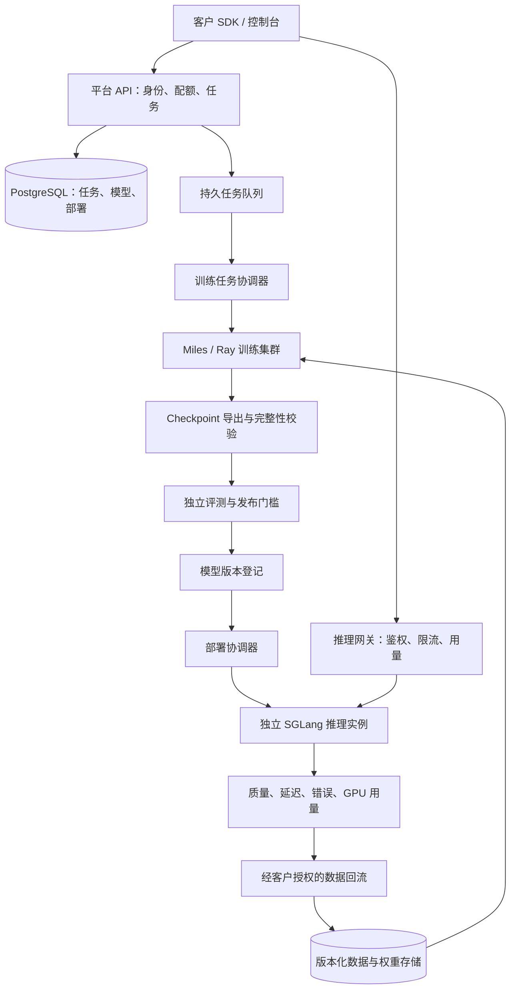

# 自建模型后训练与推理平台

状态：已完成首个 GPU 训练、导出与独立推理原型；平台控制服务尚未实现。
更新：2026-11-12 UTC。
上游基线：`radixark/miles@a18187f3efe49f6d1a8d2fbf1ffab2061e5ac69b`。

本 fork 的方向是参考 Baseten 的产品体验，用 Miles 建设自己的后训练与推理平台。
Baseten 在此是业务和体验参照；平台的首版运行路径是自有或客户提供的 GPU 集群。
这份文件是本 fork 平台方向的唯一设计入口；上游训练参数与操作步骤以对应源码和文档为准。

## 业务判断

技术上可以组合出“数据 → 后训练 → 评测 → 模型版本 → 推理 API”的产品。
Miles 解决其中的训练执行问题，平台仍需建设客户可使用的服务层与运营能力。

Baseten 已经提供 Dedicated Inference、Training Jobs、Loops 托管 SFT/RL 和 RL Rollouts。
因此，“训练加推理一体化”本身已经存在竞争。我们需要用一个明确场景验证付费意愿，
例如有自有任务数据和可执行评测的 coding-agent 团队；这个客户方向目前是待验证的假设。
试点交付应包含同一评测集上的基线与训练后模型对比、上线端点以及单位成功任务成本。

建议的商业模式是试点交付费、训练计算与管理费、推理托管费，随后再验证持续的平台订阅。
在验证实际 GPU 利用率、流量和支持成本之前，不设定未经测量的价格或利润承诺。
经营测算至少包含：GPU 租赁、空闲容量、训练重试、存储、网络和交付支持成本。

事实来源：[Baseten Training](https://www.baseten.co/products/training/)、
[Dedicated Inference](https://www.baseten.co/products/dedicated-inference/)、
[Miles](https://github.com/radixark/miles)。上面的目标客户与商业模式属于我们的产品假设。

## 能力分工

| 层 | 复用或建设 | 首版边界 |
| --- | --- | --- |
| 后训练引擎 | Miles 的训练、rollout、奖励与 checkpoint 能力 | 先打通一个已有模型配方和一种训练任务 |
| 推理引擎 | 独立运行的 SGLang | 发布经过验证的模型版本，提供兼容的聊天 API |
| 集群执行 | 先用 Ray；集群可部署在 Kubernetes 内 | 单一 GPU 环境，明确每次任务的资源配额 |
| 控制服务 | 自建 API、持久任务队列和状态协调器 | 创建、查看、取消任务；重启后恢复状态 |
| 模型登记 | 自建元数据记录，权重放对象存储 | 记录来源、版本、摘要、评测和部署关联 |
| 发布服务 | 自建部署控制与网关 | 健康检查、版本切换、回滚、API key 和限额 |
| 产品与运营 | 自建控制台、使用量记录和账单导出 | 先服务一个试点客户，核算实际交付成本 |

Miles 的 rollout SGLang 实例会随训练更新权重，不能直接承担客户的稳定生产流量。
训练与在线推理使用独立资源和模型版本；通过 checkpoint 导出与评测连接两者。
SGLang 的接口能力以[官方文档](https://docs.sglang.io/docs/basic_usage/openai_api)为准。

## 首版架构

PostgreSQL 中的任务与部署记录是平台状态的权威来源；队列负责传递工作标识。
协调器用后端任务标识反查实际状态，并通过幂等操作处理重试、服务重启和取消竞争。
模型版本包含基础模型 revision、数据版本、奖励函数版本、代码 SHA、镜像 digest、
训练配置、权重摘要和评测报告。未通过评测或产物校验的版本不可发布。

早期采用客户独享的执行环境。所有资源归属项目，元数据查询与对象存储访问都检查归属。
客户代码只在隔离执行环境内运行；平台 API 接收受支持的配方与参数，不拼接用户提供的 shell。

## 仓库中的接入点

| 接入点 | 当前用途 | 平台适配工作 |
| --- | --- | --- |
| [scripts/run_qwen3_0_6b_platform.py](scripts/run_qwen3_0_6b_platform.py) | 单机 FSDP GRPO 工程验证配方 | [部署与验证记录](deployments/platform-smoke/README.md)；后续把平台任务映射到受支持参数 |
| [train.py](train.py)、[train_async.py](train_async.py) | 训练入口 | 用后端作业运行；收集真实退出状态、日志与产物 |
| [miles/utils/external_utils/command_utils](miles/utils/external_utils/command_utils) | 启动与集群执行辅助 | 复用已有启动逻辑，避免另外维护一套训练命令 |
| [tools/convert_torch_dist_to_hf.py](tools/convert_torch_dist_to_hf.py)、[tools/convert_fsdp_to_hf.py](tools/convert_fsdp_to_hf.py) | 不同训练后端的导出工具 | 按后端与模型选转换路径，验证 tokenizer、配置和权重完整性 |
| [serve_tinker.py](serve_tinker.py)、[miles/tinker](miles/tinker) | 已有训练 API 服务实现 | 后续按模型与 multi-LoRA 条件评估复用；先验证接口和运行约束 |

导出工具的存在不代表所有模型格式可直接互转。首版必须在选定的训练后端、模型、
精度和 serving 版本上执行导出后的加载与质量回归。
普通第三方推理 API 也不能直接替换训练 rollout：训练需要核对 token、logprob、权重版本和同步语义。

## 首版交付顺序与验收

以下区分已经完成的工程原型和后续平台范围。

1. **真实 GPU 流程：已完成工程原型。** 首次验证缩小到 Qwen3-0.6B，在 4 张 A100 上
   运行两轮 FSDP GRPO，保存 checkpoint，导出并在独立 SGLang 实例加载。
   环境、产物摘要、评测、API 验证和限制统一记录在[部署说明](deployments/platform-smoke/README.md)。
   这是小样本集成验证，不代表模型效果或生产平台验收；聊天 API 与原生推理评测的差异仍待定位。
2. **封装任务与模型生命周期。** 实现任务创建、查询、取消、日志、持久队列、产物登记
   与评测门槛。验收：重复提交不产生重复训练；协调器重启可恢复观察；取消后确认
   后端任务和 GPU 分配已经释放；失败任务不会产生可发布版本。
3. **交付稳定推理端点。** 实现项目鉴权、流式响应、限额、部署健康检查、版本回滚
   与用量记录。验收：客户端能完成聊天调用；坏版本不能替换健康版本；用量记录可核对；
   跨项目请求无法读取对方资源。延迟目标在实际硬件与客户负载上测量后确定。
4. **完成一个付费试点。** 使用客户授权的数据和隔离评测集，确定成功标准后训练。
   验收：提交业务效果、延迟、失败率、单位成功任务成本与交付成本的对比报告，
   用客户实际续用或付费意愿决定是否扩展。

首版聚焦一个模型、一个后端、一个客户环境与一种可验证的业务任务。
多云容量调度、共享 GPU 多租户、广泛模型目录、自动扩缩容和支付系统在试点后排序。
Miles 的原生 Kubernetes 后端仍标为开发中，首次验证优先走 Ray；
见[后端说明](https://miles.radixark.com/docs/advanced/cluster-backend)。

## 建议的 API 资源

以下是平台 API 草案，尚无对应服务实现；它们不是 Miles 现有公开接口。

| 资源 | 拟提供的操作 | 核心行为 |
| --- | --- | --- |
| `/v1/training-jobs` | 创建、查询、取消、读取日志 | 绑定项目和预算；幂等创建；状态来自实际执行后端 |
| `/v1/model-versions` | 登记、查询、关联评测 | 不可变产物；记录基础模型与训练来源 |
| `/v1/evaluations` | 创建、查询报告 | 固定评测数据、指标与版本；训练集与评测集分离 |
| `/v1/deployments` | 创建、查询、更新版本、回滚 | 先检查就绪再切流量；记录实际运行的模型版本 |
| `/v1/chat/completions` | 调用已发布模型 | 流式返回、鉴权、限流、用量与请求标识 |
| `/v1/usage` | 查询使用量与导出 | 区分训练 GPU 时间、推理用量和存储；处理重试去重 |

## 开发与上游同步

`origin` 指向本 fork，`upstream` 指向 `radixark/miles`。
本次设计放在 `codex/platform-bootstrap` 分支，后续平台能力通过独立变更迭代。
优先把平台服务放在独立目录或独立包，以减少训练核心的分叉；确需修改核心时保留
可解释的最小改动，并按上游相关规则验证。

开发前遵循 [AGENTS.md](AGENTS.md) 及其引用规则。
本仓库包含 Apache-2.0 [LICENSE](LICENSE) 与 [NOTICE](NOTICE)；保留来源和相应声明。
基础模型、数据和新增依赖各有自己的许可条件，不能从 Miles 的许可证推定它们的权限。
此项目与 Baseten、RadixArk 无官方隶属或背书关系。

## 当前完成与下一阶段

- 已完成：Miles fork、平台设计、真实 GPU 训练、checkpoint 导出与完整性检查、独立推理 API。
- 待实现：本文件描述的控制服务、平台 API、模型登记、发布、计量与控制台。
- 待验证：推理接口间的评测一致性、客户业务效果、可靠性与成本。
- 下一阶段：在已授权 GPU 环境封装任务与模型生命周期；确定试点任务、计算预算和客户授权数据。
